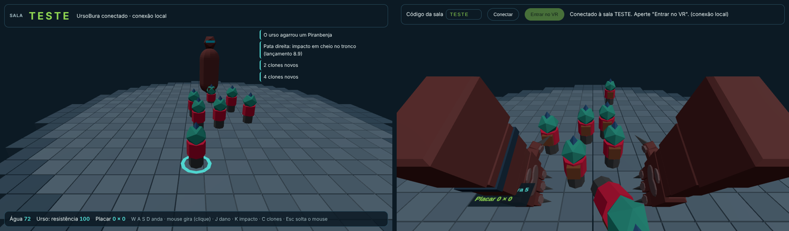
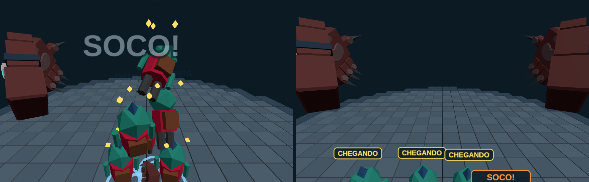
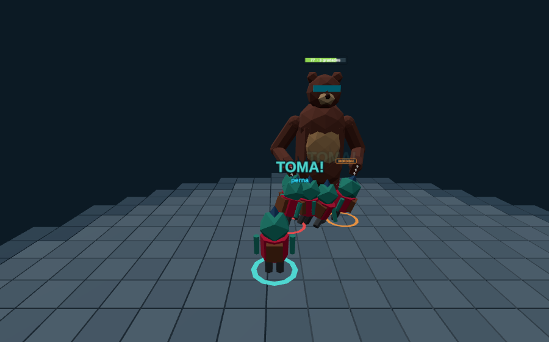

# Diário do LUTCHA!!!

Linha do tempo do desenvolvimento: concepts, opções de arte, trechos do game design e testes.

## 25/10/2026 — As patas do UrsoBura

No VR, quem joga de UrsoBura vê as próprias mãos como patas de urso: pelo marrom, três garras e as almofadinhas na palma. Os dedos acompanham o gatilho e o grip do controle. A primeira página do repositório serve para testar as patas no Quest, com o soco furadeira (um tornado em volta do pulso), o sabre laser e a carga das agulhas.

## 25/10/2026 — Protótipo cinza: a primeira luta

Primeira luta de verdade, ainda com formas simples. O Piranbenja anda pelo ringue de blocos no PC, cria clones e ataca; o UrsoBura entra pelo Quest, soca, empurra, agarra e arremessa. Um Piranbenja arremessado derruba os outros como pinos de boliche ("STRIKE!"). O golpe muda conforme o lugar (cabeça, tronco, braços ou pernas) e o jeito (em cheio ou de raspão), e o controle vibra no mesmo instante. Os clones são idênticos ao original: só quem joga no PC sabe quem é quem.

## 26/10/2026 — Rodada 2 do urso: cada golpe com seu jeito

Depois do primeiro teste no Quest, o urso ganhou golpes diferentes conforme a mão e o movimento: soco para frente, soco de lado que faz rolar, gancho que joga para cima girando, martelada que achata no chão, arranhão largo e estocada. Os clones colados levam o golpe "de tabela", ficam tontos com estrelinhas e avisam antes de atacar. Agarrar um Piranbenja agora faz ele balançar solto, preso só pela parte que a pata segura. E o braço do urso estica para baixo, para alcançar os pequenos sem precisar se agachar.

## 26/10/2026 — O Piranbenja entra na luta (teste no PC)

Agora dá para jogar de Piranbenja sozinho no computador, contra um UrsoBura controlado pelo jogo: ele pode ficar parado como boneco de treino, andar meio bobo ou partir para cima, batendo, agarrando e arremessando. O urso ganhou corpo inteiro, com braços de verdade ligados aos ombros, e ninguém atravessa ninguém. O Piranbenja dá tapas e socos; os clones também mordem, e quem morde fica grudado no braço do urso, balançando junto, até ser sacudido ou arrancado. E a mochila do Piranbenja voltou para as costas.

## 26/10/2026 — Agora o urso voa

Depois de jogar com uma criança de verdade, o UrsoBura parecia impossível de derrotar. Os tapas e as mordidas ficaram mais fortes, a água enche mais rápido e o urso anda mais devagar. Três socos juntos num urso cansado fazem ele decolar num arco de anime, em câmera lenta, e quem joga no óculos voa junto. Também nasceram as armadilhas de morder, o clone salva-vidas (criar clones enquanto cai do ringue te traz de volta) e um truque para confundir o urso: ao criar clones, as estrelinhas de tontura do original passam para um clone.
