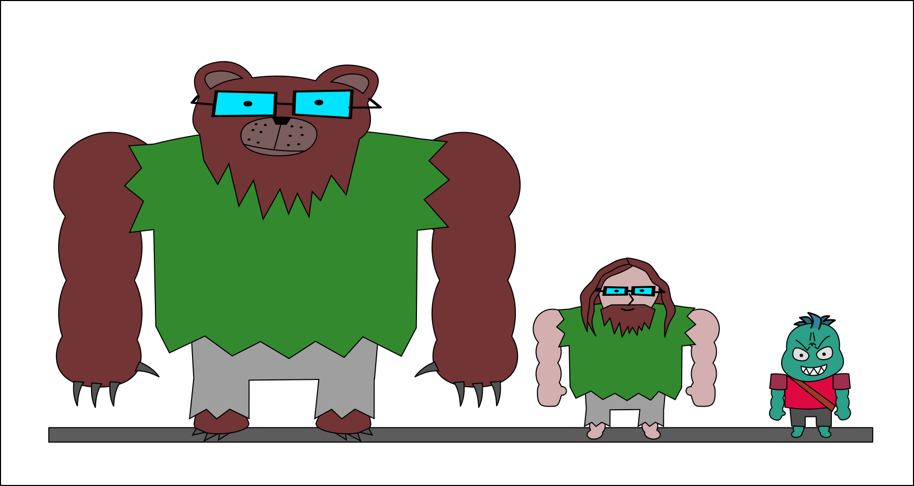

# Diário do LUTCHA!!!

Linha do tempo do desenvolvimento: concepts, opções de arte, trechos do game design e testes.

## 25/10/2026 — As patas do UrsoBura

No VR, quem joga de UrsoBura vê as próprias mãos como patas de urso: pelo marrom, três garras e as almofadinhas na palma. Os dedos acompanham o gatilho e o grip do controle. A primeira página do repositório serve para testar as patas no Quest, com o soco furadeira (um tornado em volta do pulso), o sabre laser e a carga das agulhas.

